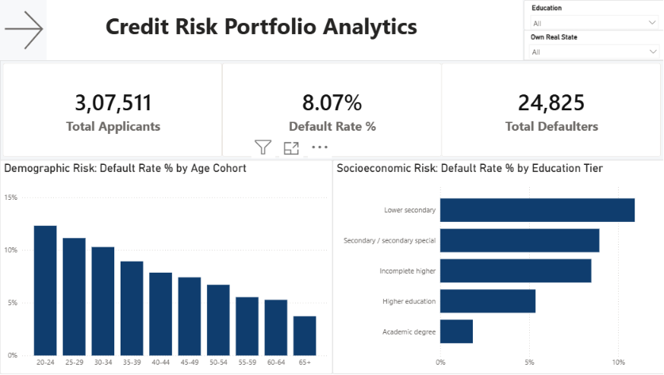
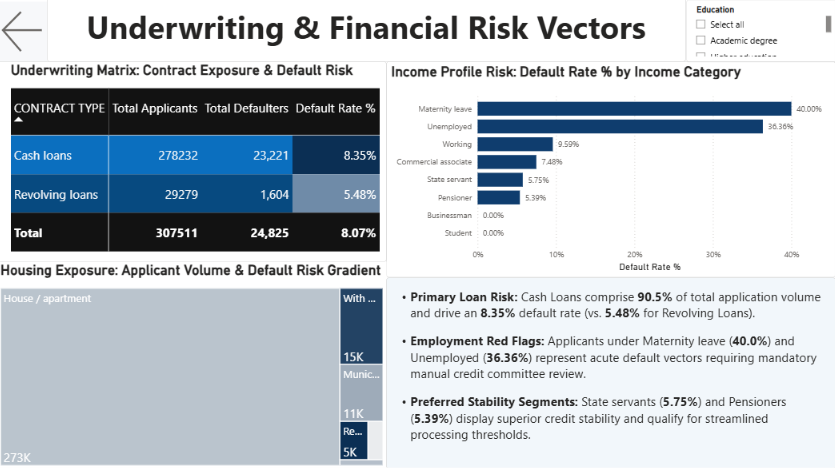

# Credit Risk Analysis & Loan Default Prediction

An end-to-end credit-risk analytics project using the Home Credit Default Risk dataset. The project compares interpretable and tree-based classifiers, calibrates default probabilities, evaluates an illustrative cost-sensitive decision rule, and examines whether historical bureau and previous-application aggregates add predictive signal.

> **Result status:** The code and evaluation procedure are being corrected on the `fix/audit-corrections` branch. The currently committed files under `results/` were generated before these corrections and must be regenerated by running the updated extension notebook from a clean kernel. Treat existing headline numbers and plots as provisional until that rerun and the verification script pass.

## Business question

Can application information and historical relationship aggregates help rank applicants by default risk, and how does a decision threshold change the trade-off between approving a future defaulter and declining a non-defaulter?

The target is `TARGET` (1 = default, 0 = non-default). The main source is the Home Credit Default Risk application table. Supplementary tables are used only for applicant-level historical aggregates.

## Methods

1. **Data preparation:** deterministic feature engineering, schema checks, missing-value handling within model pipelines, and removal of the applicant identifier.
2. **Feature policy:** the default policy excludes `CODE_GENDER`, `NAME_FAMILY_STATUS`, `NAME_TYPE_SUITE`, `CNT_CHILDREN`, and `CNT_FAM_MEMBERS`. `AGE_YEARS` remains available to the model but is not mapped to an explanation. `NAME_INCOME_TYPE` remains and may act as a proxy for sensitive circumstances. This is an illustrative feature policy, **not a fair-lending test or a claim of legal compliance**.
3. **Model comparison:** five-fold stratified cross-validation on the training partition, using out-of-fold PR-AUC as the primary ranking metric. ROC-AUC, Gini, KS, Brier score, log-loss, and fold variability are secondary diagnostics. Hyperparameters are fixed; no hyperparameter search is claimed. For weighted boosted-tree CV, `scale_pos_weight` is recalculated from each fold's training labels only; the final refit uses the full training-partition class ratio.
4. **Probability calibration:** isotonic calibration is cross-fitted for training-side decisions. The final calibration mapping is fitted to the complete training OOF predictions and applied to the untouched test predictions. Reported test calibration metrics should be calculated on the holdout set, not inferred from the calibrator's training data.
5. **Decision-cost illustration:** the notebook assumes LGD = 0.45, an opportunity cost of declining a non-defaulter = 0.09, and therefore a cost ratio of 5. EAD is approximated by `AMT_CREDIT`. These are **illustrative economic assumptions**, not retail Basel F-IRB parameters. Costs are expressed in dataset currency units; no currency is asserted. The metric is called *expected decision cost*, not credit loss.
6. **Decision threshold:** the threshold is selected from cross-fitted calibrated training predictions. The holdout test set is not used to select the model or threshold. The raw weighted-score threshold of 0.50 is retained only as a reference, not as a calibrated policy.
7. **Explainability:** SHAP is used to inspect drivers of the selected tree model's raw output. These explanations are not calibrated-probability explanations and are **not legally validated adverse-action reason codes**. No regulatory compliance conclusion is made.
8. **Relational ablation:** bureau and previous-application history are aggregated per applicant without using `TARGET`. Their predictive lift must be checked fold by fold before it is described as robust.

## Repository layout

```text
Credit_Risk_Project/
├── Notebooks/
│   ├── credit_risk_analysis.ipynb       # Frozen v1 baseline
│   └── modeling_extension.ipynb         # Model comparison and decision analysis
├── src/
│   ├── config.py                        # Paths, seeds, feature policy, assumptions
│   ├── features.py                      # Application feature engineering/pipelines
│   ├── costs.py                         # Calibration and expected decision cost
│   ├── evaluate.py                      # Cross-validation and bootstrap evaluation
│   └── bureau_features.py               # Bureau/history aggregations
├── results/                             # Generated CSV/NPY tables and run manifest
├── scripts/
│   ├── verify_notebook.py               # Notebook syntax and stale-output checks
│   └── verify_results.py                # Result-integrity checks after a clean rerun
├── tests/test_core.py                   # Dataset-independent helper tests
├── .github/workflows/core-checks.yml    # CI on Python 3.12 and 3.14
├── assets/                              # Generated evaluation and SHAP figures
├── sql/                                 # PostgreSQL analytical artifacts
├── dashboards/                          # Power BI dashboard (if included locally)
├── requirements.txt
└── README.md
```

Raw data are not included. Place the official files in `data/raw/`:

- `application_train.csv`
- `bureau.csv`
- `previous_application.csv`

The project ignores raw data files so they are not committed to Git.

## SQL and Power BI reporting

The Python workflow handles model development and generated evaluation artifacts. PostgreSQL and Power BI provide the separate analyst/stakeholder view:

- `sql/core_artifacts.sql` creates `analytics.v_credit_risk_engineered` and includes cohort-level default-rate queries, income tiers, organization-type comparisons, age-cohort analysis, and a defaulter/non-defaulter financial-burden summary.
- Before running the SQL file, import the cleaned application data into PostgreSQL as `public.credit_risk_data` using lower-case column identifiers. The age and loan-to-income queries read from the engineered view rather than assuming derived columns already exist in the base table.
- `dashboards/credit_risk_dashboard.pbix` is the Power BI artifact. The screenshots below are included as dashboard previews; refresh the underlying tables and re-check unit labels after regenerating the data/model outputs.

### Dashboard previews





## Business questions supported by the project

The project is designed to answer the following questions. Final numeric answers should be taken from the regenerated result files, not the older committed CSVs.

| Business question | Source of the current answer |
|---|---|
| How does default prevalence vary across borrower and income cohorts? | SQL queries in `sql/core_artifacts.sql` and the Power BI cohort visuals |
| How do model quality and calibration compare across candidates? | `results/cv_metrics.csv`, `results/cv_fold_metrics.csv`, and `results/test_calibration.csv` |
| How does the selected decision threshold change approval and risk outcomes? | `results/test_operating_points.csv` and `results/headline_costs.csv` |
| Do bureau and previous-application aggregates add predictive signal consistently across folds? | `results/ablation_study.csv` and `results/ablation_fold_diffs.csv` |
| How stable are tree-SHAP and logistic-regression feature rankings after reducing collinear feature triplets? | `results/shap_lr_rank_correlation.csv` and `results/shap_lr_rank_correlation_robust.csv` |

## Reproducing the analysis

Use a fresh Python environment compatible with the packages in `requirements.txt`.

### Windows PowerShell

```powershell
git clone https://github.com/godiyajatin-ops/Credit_Risk_Project.git
cd Credit_Risk_Project
python -m venv .venv
.\.venv\Scripts\Activate.ps1
python -m pip install --upgrade pip
pip install -r requirements.txt
```

### macOS / Linux

```bash
git clone https://github.com/godiyajatin-ops/Credit_Risk_Project.git
cd Credit_Risk_Project
python -m venv .venv
source .venv/bin/activate
python -m pip install --upgrade pip
pip install -r requirements.txt
```

1. Put the three raw CSV files in `data/raw/`.
2. Open `Notebooks/credit_risk_analysis.ipynb` from the repository root in Jupyter and run all cells. Confirm the baseline reconciliation assertion passes; the core baseline model procedure is unchanged.
3. Open `Notebooks/modeling_extension.ipynb`, restart its kernel, and run all cells in order. This regenerates scorecards and figures under `results/` and `assets/`, including a run manifest.
4. Run the verification script from the repository root:

   ```bash
   python scripts/verify_results.py
   ```

The full notebook includes five-fold model fitting and SHAP computation, so runtime depends on hardware and installed library versions.

## Results and interpretation

The updated notebook writes machine-readable outputs instead of requiring values to be typed into this document. Key artifacts include:

- `results/cv_metrics.csv` and `results/cv_fold_metrics.csv`: model and fold-level ranking metrics.
- `results/threshold_table.csv`: training-side threshold sensitivity under the illustrative cost ratios.
- `results/test_metrics.csv` and `results/test_paired_diffs.csv`: holdout bootstrap intervals and paired comparisons, including champion versus runner-up.
- `results/champion_runnerup_fold_diffs.csv`: fold-aligned PR-AUC and ROC-AUC differences between XGBoost and LightGBM.
- `results/test_calibration.csv`: raw-score versus calibrated test Brier score, mean predicted probability versus observed prevalence, and score discreteness diagnostics.
- `results/headline_costs.csv`: point estimates for approving everyone, v1 at 0.50, v1 at its own OOF-calibrated threshold, and the selected champion policy.
- `results/test_scored.csv`: locked holdout predictions used to audit point estimates.
- `results/imbalance_study.csv`: the tested class-imbalance configurations.
- `results/ablation_study.csv` and `results/ablation_fold_diffs.csv`: relational feature-store comparison and fold-level changes.
- `results/fair_lending_ablation.csv`: predictive sensitivity to the configured feature exclusions; not a fairness assessment.
- `results/shap_lr_rank_correlation.csv` and `results/shap_lr_rank_correlation_robust.csv`: descriptive comparison of linear coefficients and tree SHAP rankings, including a sensitivity check that keeps one representative per `_AVG`/`_MODE`/`_MEDI` group.
- `results/shap_reason_codes.csv`: illustrative risk-driver descriptions, not legal notices.
- `results/run_manifest.json`: champion, data split, feature counts, assumptions, and environment versions.
- `results/thin_file_segments.csv`: holdout metrics by whether an applicant has linked bureau history; descriptive only.

After rerunning, interpret PR-AUC relative to default prevalence and include uncertainty when comparing models. A small difference between XGBoost and LightGBM should be described as inconclusive when the paired holdout interval includes zero and fold-level results do not show a consistent advantage. Do not present a model's ranking lift as proof of causal structure, regulatory compliance, or deployment readiness.

## Limitations

- One dataset and one fixed train/test split are used; external and temporal validation are not included.
- `requirements.txt` currently defines bounded compatibility ranges, not a fully pinned lockfile. The run manifest records the exact versions used for a validated execution; produce a lockfile from the environment that completes the full notebook rerun before claiming bit-for-bit reproducibility.
- Hyperparameters are fixed rather than tuned.
- The cost function is a simplified decision-analysis scenario. It omits funding costs, capital requirements, recovery timing, pricing, exposure dynamics, and many operational constraints.
- Excluding selected attributes does not establish fairness. Dedicated subgroup metrics, proxy analysis, legal review, and governance validation have not been completed.
- SHAP explains the model output under the chosen explainer configuration; it does not, by itself, establish causality or satisfy adverse-action disclosure requirements.
- Better ranking metrics do not prove that the resulting underwriting policy is suitable for a real lender.

## License and data

Use the dataset under the terms provided by its original publisher. Confirm the licensing and redistribution terms for any external dataset, dashboard, or asset before redistributing the complete repository.
