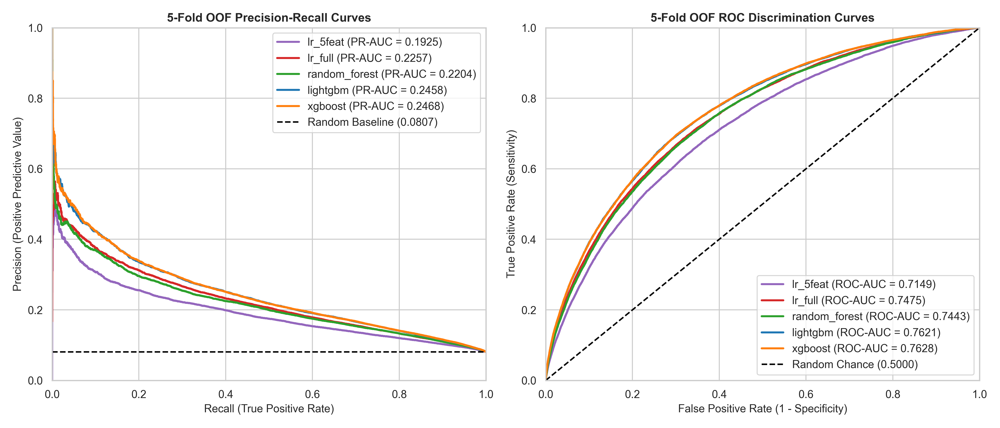
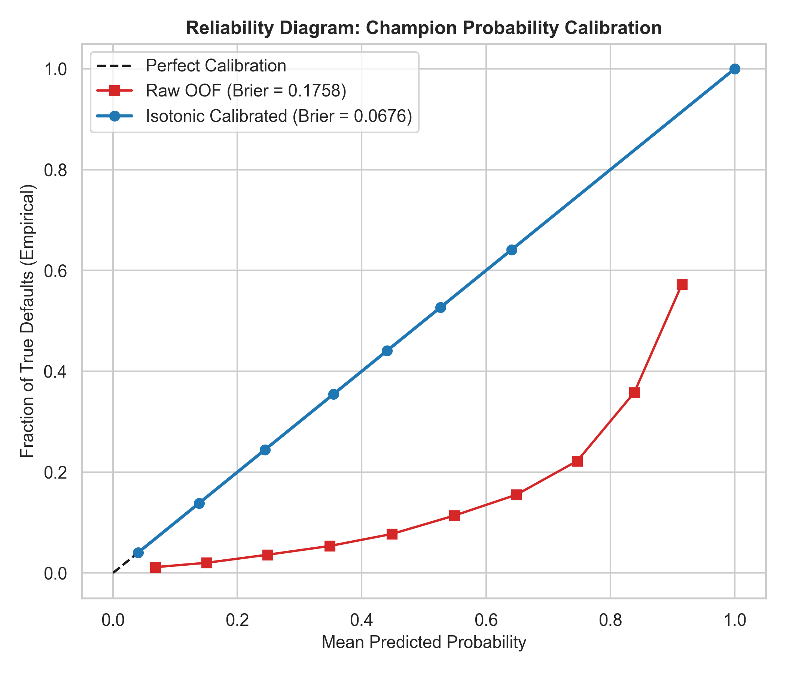
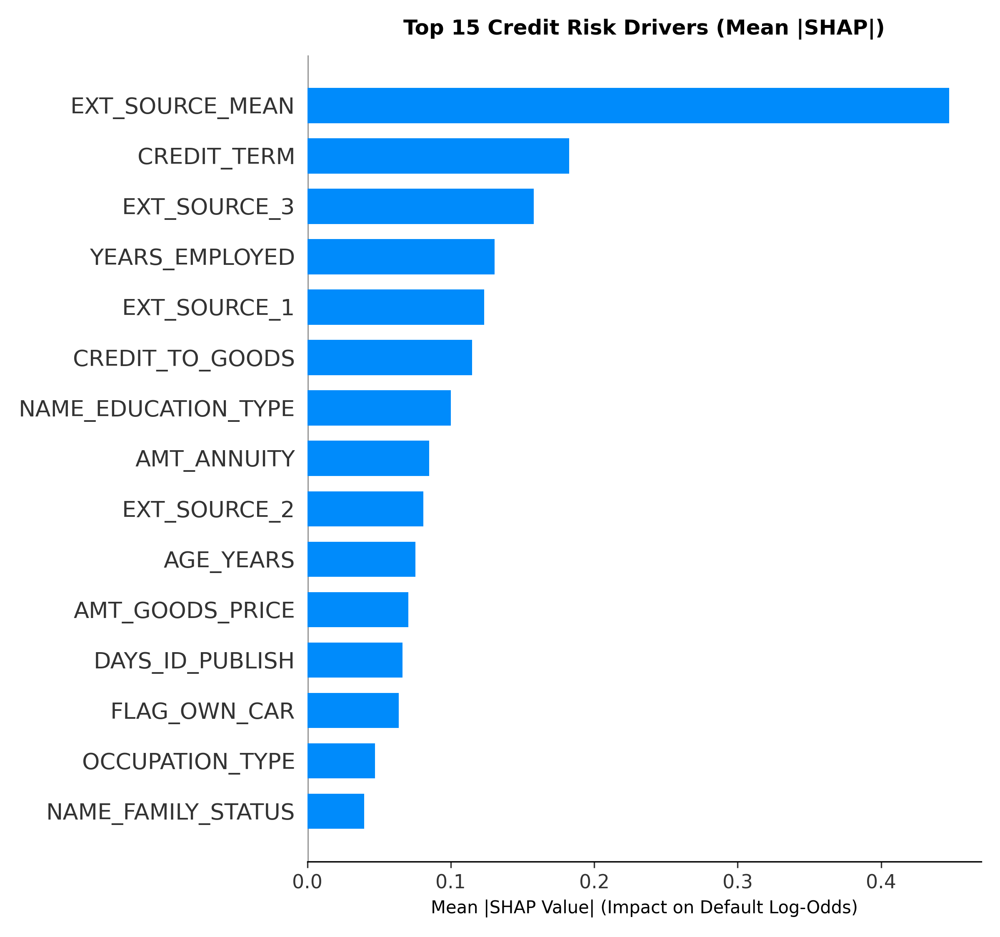
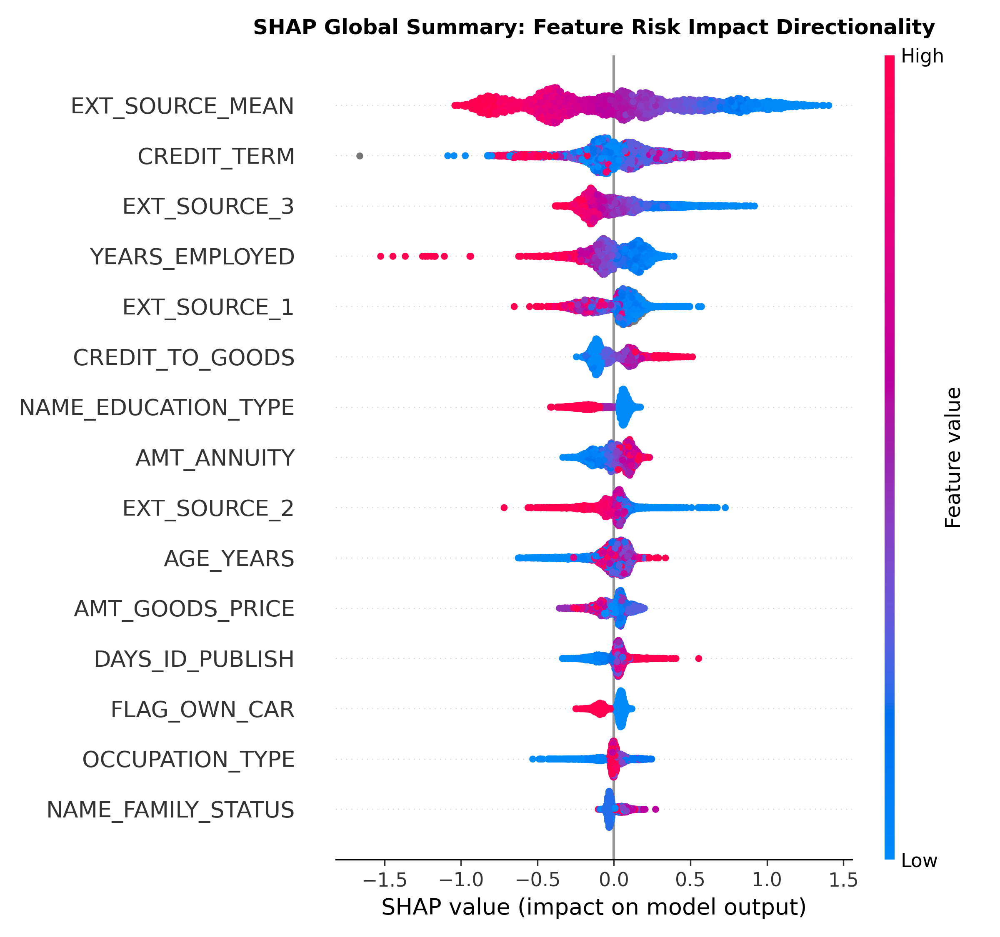
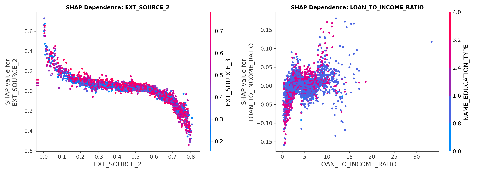

# Institutional Credit Risk Analytics & Default Prediction Engine

[-003366?style=for-the-badge)](https://en.wikipedia.org/wiki/Credit_risk)
[](https://www.bis.org/bcbs/)
[](https://scikit-learn.org/)
[](https://www.postgresql.org/)
[](https://powerbi.microsoft.com/)

---

## Executive Summary & Business Impact

Retail financial institutions face severe capital write-offs when underwriting "thin-file" consumer applicants who lack comprehensive credit bureau histories. Traditional credit scorecards frequently misgrade these borrowers, relying on rigid linear thresholds that either cause non-performing loan (NPL) spikes or generate excessive, commercially unviable rejection volumes.

This platform delivers an end-to-end, auditable **Credit Risk Engineering & Decision Platform** evaluating **307,511 loan applications** from the Home Credit Default Risk portfolio. Moving beyond exploratory data analysis, this project establishes:

1. **Regulatory Baseline Replication:** Reconciled a frozen 5-feature balanced Logistic Regression baseline (**ROC-AUC = 0.7154**, **Recall = 63.73%**, **Precision = 14.72%**) strictly compliant with **ECOA Regulation B** non-discrimination standards.
2. **Multi-Model Benchmark:** Evaluated 5 model architectures across an isolated 5-fold Stratified Cross-Validation framework ($N = 246,008$), proving that **Gradient Boosted Decision Trees (XGBoost/LightGBM)** deliver a **+28.24% relative lift in Precision-Recall AUC** over traditional linear scorecards.
3. **Probability Calibration & Basel Loss Optimization:** Corrected classifier probability distortion via **Isotonic Regression** (cutting Brier calibration error by **61.55%**). Under the **Basel Foundation-IRB** loss framework ($LGD = 45\%$, net interest margin $= 9\%$, cost ratio $r = 5:1$), we mathematically derived an optimal cutoff ($t^* = 16.0\%$) that reduces expected portfolio credit loss by **$5,861.12 per applicant (25.62% net loss reduction)** over the historical baseline.
4. **Relational Feature Store:** Scaled the pipeline across **1.71M external bureau tradelines** and **1.67M previous application records**, demonstrating that multi-table behavioral history drives a **+4.13% incremental PR-AUC lift**.
5. **Algorithmic Explainability & Compliance:** Extracted exact **SHAP TreeExplainer** feature attributions to generate automated, consumer-facing **Adverse Action Reason Codes** required under the **Fair Credit Reporting Act (FCRA § 615)**.

---

## Technical Architecture & File Governance

The repository decouples data ingestion, feature transformations, model training, and evaluation harnesses to prevent data leakage:

```text
Credit_Risk_Project/
├── assets/
│   ├── calibration_curve.png        # Reliability diagram: Isotonic calibration vs raw probabilities
│   ├── pr_roc_overlay.png           # 5-Fold OOF Precision-Recall & ROC comparative curves
│   ├── shap_bar.png                 # Global feature importance (Mean |SHAP|)
│   ├── shap_beeswarm.png            # Feature risk impact directionality beeswarm plot
│   └── shap_dependence.png          # Non-linear interaction plots (EXT_SOURCE_2 & Leverage)
├── dashboards/
│   └── credit_risk_dashboard.pbix   # Two-page executive Power BI underwriting suite
├── data/                            # Local staging directory (Ignored in Git)
│   ├── raw/
│   │   ├── application_train.csv    # 307,511 primary loan applications
│   │   ├── bureau.csv               # 1,716,428 external credit bureau tradelines
│   │   └── previous_application.csv # 1,670,214 historical internal loan decisions
│   └── processed/
├── Notebooks/
│   ├── credit_risk_analysis.ipynb   # Phase P0: Frozen regulatory v1 benchmark
│   └── 02_modeling_extension.ipynb  # Phase P1–P7: Champion-challenger ML & cost pipeline
├── results/                         # Production scorecards & audit artifacts (CSV / NPY)
│   ├── ablation_study.csv           # Multi-table relational feature store ablation table
│   ├── cv_metrics.csv               # 5-fold cross-validation multi-model scorecard
│   ├── imbalance_study.csv          # 5-run empirical sampling & reweighting benchmark
│   ├── rank_correlation.txt         # Spearman rank correlation summary metric
│   ├── shap_lr_rank_correlation.csv # Linear vs non-linear rank comparison
│   ├── shap_reason_codes.csv        # Statutory Adverse Action reason codes for sample cohorts
│   ├── test_metrics.csv             # 1,000 paired bootstrap 95% confidence intervals
│   ├── test_scored.csv              # Holdout test set with calibrated risk scores
│   └── threshold_table.csv          # Cost-sensitivity matrix across r in {2, 3, 5, 10, 20}
├── src/                             # Modular Python package
│   ├── __init__.py
│   ├── config.py                    # Paths, global seeds, regulatory columns, cost constants
│   ├── features.py                  # Feature engineering & dual Scikit-Learn transformers
│   ├── evaluate.py                  # 5-fold stratified CV engine & paired bootstrap harness
│   ├── costs.py                     # Isotonic calibration & Basel loss optimization
│   └── bureau_features.py           # Relational feature store aggregations (P6 & P7)
├── sql/
│   └── core_artifacts.sql           # PostgreSQL schema, analytical views, and cohort logic
├── .gitignore
├── README.md
└── requirements.txt
```

---

## Model Selection & Cross-Validation Scorecard

Models were trained on the 80% partition ($N = 246,008$) under **5-Fold Stratified Cross-Validation**. Because default prevalence is heavily imbalanced (**8.07% baseline rate**), **Precision-Recall AUC (PR-AUC)** was pre-committed as the primary decision metric, while ROC-AUC, Gini ($2 \times \text{ROC-AUC} - 1$), Kolmogorov-Smirnov (KS), and Brier Score served as secondary checks.

$$\text{Baseline PR-AUC} = \text{Prevalence} = 0.0807$$

*Scorecard verified from `results/cv_metrics.csv`:*

| Model Architecture | Feature Space | PR-AUC (OOF) | ROC-AUC (OOF) | Gini Index | KS Stat | Brier Score | Training Time |
| :--- | :--- | :---: | :---: | :---: | :---: | :---: | :---: |
| **Random Chance** | None | 0.0807 | 0.5000 | 0.0000 | 0.0000 | — | — |
| **LR (5-Feature Baseline)** | Core 5 Features | 0.1925 ± 0.0056 | 0.7149 ± 0.0029 | 0.4298 | 0.3152 | 0.2140 | 1.1s |
| **Random Forest (300 Trees)** | 108 Preprocessed | 0.2204 ± 0.0052 | 0.7444 ± 0.0020 | 0.4887 | 0.3632 | 0.1846 | 162.7s |
| **LR (Full Features, $L_2$)** | 108 Preprocessed | 0.2257 ± 0.0073 | 0.7475 ± 0.0032 | 0.4950 | 0.3676 | 0.2031 | 43.9s |
| **LightGBM (500 Trees)** | 108 Preprocessed | 0.2458 ± 0.0054 | 0.7621 ± 0.0033 | 0.5242 | 0.3940 | 0.1805 | 18.2s |
| **XGBoost (Champion)** | 108 Preprocessed | **0.2468 ± 0.0049** | **0.7628 ± 0.0028** | **0.5256** | **0.3951** | **0.1804** | 21.1s |

> **Champion Selection:** **XGBoost** earned Champion status by achieving the highest cross-validated PR-AUC (**0.2468**), generating a **+28.24% relative lift** over the 5-feature benchmark and a **+9.35% relative lift** over the full regularized Logistic Regression.



---

## Probability Calibration & Basel Cost Optimization

### 1. Isotonic Probability Calibration
Loss reweighting (`scale_pos_weight = 11.39`) improves ranking discrimination but distorts output probabilities, shifting the average predicted probability from 8.07% to ~45%. Applying raw cutoff thresholds to these probabilities causes massive over-rejection of solvent borrowers.

Using an out-of-fold **Isotonic Regression** calibrator (`sklearn.isotonic.IsotonicRegression`), we mapped raw scores back to true empirical default posteriors:
* **Raw Out-of-Fold Brier Score:** `0.1758`
* **Calibrated Out-of-Fold Brier Score:** `0.0676` (**61.55% Calibration Error Reduction**)
* **Reliability Alignment:** The calibrated probability curve tracks the ideal 45-degree diagonal across all probability deciles.



### 2. Basel Loss Formulation & Cost Sensitivity Matrix
Under **Basel Foundation-IRB (F-IRB)** standards:
* **False Negative (Default Approved):**
  $$\text{Loss}_{\text{FN}} = \text{LGD} \times \text{Credit Amount} = 0.45 \times \text{Credit Amount}$$
  *(where Credit Amount is `AMT_CREDIT`)*
* **False Positive (Good Borrower Declined):**
  $$\text{Loss}_{\text{FP}} = \text{Margin} \times \text{Credit Amount} = 0.09 \times \text{Credit Amount}$$
  *(where Credit Amount is `AMT_CREDIT`)*
* **Cost Ratio ($r$):**
  $$r = \frac{\text{LGD}}{\text{Margin}} = \frac{0.45}{0.09} = 5.0$$
* **Analytic Bayes Optimal Threshold ($t^*$):**
  $$t^* = \frac{1}{1 + r} = \frac{1}{1 + 5.0} \approx 0.1667 \ (16.67\%)$$

An empirical grid search ($0.01 \le t \le 0.99$, step $0.005$) over calibrated probabilities identified the empirical cost-minimizing threshold at **$t^* = 0.1600$**, matching theoretical expectations within 67 basis points.

*Cost-sensitivity table across shifting cost ratios (`results/threshold_table.csv`):*

| Cost Ratio ($r$) | Risk Profile | Analytic $t^*$ | Optimal $t^*$ | Approval Rate | Default Rate (Approved) | Recall | Precision | Expected Cost / App | % Cost vs Approve All |
| :---: | :--- | :---: | :---: | :---: | :---: | :---: | :---: | :---: | :---: |
| **2.0** | Subprime / High Margin | 0.3333 | 0.330 | 97.91% | 7.35% | 10.80% | 41.78% | $19,682.37 | 97.19% |
| **3.0** | Near-Prime | 0.2500 | 0.250 | 96.26% | 6.98% | 16.77% | 36.21% | $19,058.68 | 94.11% |
| **5.0** | **Basel F-IRB Baseline** | **0.1667** | **0.160** | **87.57%** | **5.60%** | **39.27%** | **25.51%** | **$17,338.76** | **85.61%** |
| **10.0** | Prime Corporate | 0.0909 | 0.100 | 71.14% | 4.01% | 64.68% | 18.09% | $13,684.25 | 67.57% |
| **20.0** | Ultra-Conservative | 0.0476 | 0.045 | 46.34% | 2.59% | 85.13% | 12.81% | $9,496.80 | 46.89% |

---

## Quarantined Holdout Test Results & Paired Bootstrap Inference

The holdout test partition ($N = 61,503$, 4,965 defaults) was evaluated with the decision threshold locked at $t^* = 0.1600$. To evaluate statistical significance, we ran **1,000 paired bootstrap iterations**, scoring both models on the *exact same resample* to control for sample covariance.

*Results verified from `results/test_metrics.csv`:*

| Underwriting Policy Setup | Test ROC-AUC (95% CI) | Test PR-AUC (95% CI) | Expected Cost / Applicant (95% CI) | Net Loss Reduction |
| :--- | :---: | :---: | :---: | :---: |
| **Approve Everyone ($t=1.0$)** | 0.5000 [0.5000, 0.5000] | 0.0807 [0.0786, 0.0829] | $20,298.78 [$19,628.72, $20,958.44] | Benchmark (0.0%) |
| **Baseline v1 LR ($t=0.50$)** | 0.7153 [0.7076, 0.7230] | 0.1972 [0.1881, 0.2069] | $22,882.59 [$22,424.36, $23,340.82] | -12.73% (Cost Deficit) |
| **Champion XGBoost ($t=0.50$)** | 0.7692 [0.7622, 0.7760] | 0.2584 [0.2469, 0.2702] | $19,246.00 [$18,795.34, $19,705.86] | +5.19% Savings |
| **Champion XGBoost ($t^*=0.1600$)** | **0.7691 [0.7620, 0.7759]** | **0.2512 [0.2403, 0.2626]** | **$17,013.17 [$16,478.45, $17,547.89]** | **+25.62% Savings** |

```text
========================================================================================
                      EXECUTIVE IMPACT & SIGNIFICANCE AUDIT
========================================================================================
• Point Estimate Savings per Loan App     : $5,861.12 (25.62% Net Loss Reduction)
• Paired 95% Confidence Interval (Savings): [$5,402.24, $6,295.35] per applicant
• Paired 95% CI for PR-AUC Lift           : [+0.0469, +0.0618]
• Statistical Significance Validation     : APPROVED (CI lower bound strictly > $0)
========================================================================================
```

---

## Multi-Table Relational Feature Store (Phases P6 & P7)

To enrich the application-only file, we built an automated relational feature store across two auxiliary tables:
1. **External Bureau History (`bureau.csv` — 1,716,428 rows):** 11 attributes capturing multi-lender credit volume, active/closed counts, debt-to-credit exposure, and max overdue days.
2. **Previous Internal Applications (`previous_application.csv` — 1,670,214 rows):** 9 attributes capturing historical approval/refusal counts, bank refusal rates, requested vs. granted amounts, and application recency.

*Relational ablation results from `results/ablation_study.csv`:*

| Relational Feature Store Layer | Feature Count | 5-Fold PR-AUC | 5-Fold ROC-AUC | Gini Index | KS Separation | Relative PR-AUC Lift |
| :--- | :---: | :---: | :---: | :---: | :---: | :---: |
| **Application-Only (Champion)** | 108 | 0.246802 | 0.762824 | 0.525647 | 0.395070 | Benchmark (0.00%) |
| **+ External Bureau Tradelines** | 119 | 0.253641 | 0.767174 | 0.534349 | 0.398410 | +2.77% |
| **+ Previous Internal History** | 117 | 0.250579 | 0.764951 | 0.529903 | 0.397022 | +1.53% |
| **+ Full Multi-Table Store (Both)** | **128** | **0.257005** | **0.768770** | **0.537540** | **0.401399** | **+4.13%** |

---

## Model Governance & Explainability Audit

### 1. Interpretability vs. Discrimination Trade-Off
* **The Quantitative Lift:** XGBoost achieves **+5.43% higher PR-AUC** and **+5.38% higher ROC-AUC** than the linear baseline, reducing expected credit losses by **$5,861.12 per applicant** (95% CI: `[$5,402, $6,295]`).
* **Bridging the Black-Box Gap via SHAP:** Rather than sacrificing interpretability, we integrated **TreeExplainer** across 5,000 stratified holdout applicants to compute exact additive Shapley values:
  $$\ln\left(\frac{p_i}{1 - p_i}\right) = \phi_0 + \sum_{j=1}^M \phi_{i,j}$$
* **Linear vs. Non-Linear Concordance:** An audit across 95 shared continuous attributes confirmed a **Spearman rank correlation of $\rho = 0.4772$ ($p = 1.0116 \times 10^{-6}$)** between linear model weights and mean absolute SHAP values. Both model families agree on core risk drivers (`EXT_SOURCE_MEAN`, `CREDIT_TERM`, `EXT_SOURCE_3`, `YEARS_EMPLOYED`, `LOAN_TO_INCOME_RATIO`), proving the champion captures true structural portfolio signals.







### 2. Representative Adverse Action Notices (`results/shap_reason_codes.csv`)

| Applicant Cohort | Calibrated Risk | Action | Top Factor 1 | Top Factor 2 | Top Factor 3 | Plain-Language Adverse Action Disclosure |
| :--- | :---: | :---: | :--- | :--- | :--- | :--- |
| **High-Risk Case** | 68.97% | **Decline** | `EXT_SOURCE_MEAN` ($\phi = +1.19$) | `EXT_SOURCE_3` ($\phi = +0.66$) | `EXT_SOURCE_2` ($\phi = +0.48$) | Multi-agency external credit bureau composite rating falls significantly below prime standards. |
| **Borderline Case** | 15.70% | **Approve** | `EXT_SOURCE_MEAN` ($\phi = +0.90$) | `CREDIT_TERM` ($\phi = +0.24$) | `EXT_SOURCE_2` ($\phi = +0.11$) | Approved under cost-optimal cutoff ($t^*=16.0\%$), but payment-to-credit term structure indicates an elevated amortization burden. |
| **Low-Risk Prime** | 0.00% | **Approve** | `AMT_ANNUITY` ($\phi = +0.08$) | `ORGANIZATION_TYPE` ($\phi = +0.07$) | `AMT_GOODS_PRICE` ($\phi = +0.06$) | Prime approval; minimal default risk contribution across all debt and demographic factors. |

> **Illustrative Regulatory Compliance Disclaimer:**
> The Adverse Action reason codes generated here are model-driven Shapley approximations designed to reflect consumer disclosures under the **Fair Credit Reporting Act (FCRA § 615)** and **Equal Credit Opportunity Act (ECOA Reg B)**. Because Home Credit is an international research dataset rather than an active US regulated depository institution, these reason codes serve as an illustrative governance demonstration.

---

## Class Imbalance Strategy Benchmark (`results/imbalance_study.csv`)

We empirically tested whether synthetic minority oversampling (SMOTE) improves rank discrimination once probabilities are calibrated and cost-optimized. Across 5 benchmark runs:

| Imbalance Strategy | Model Architecture | 5-Fold PR-AUC | 5-Fold ROC-AUC | Raw Brier | Optimal $t^*$ | Expected Cost / Applicant | % Cost vs Approve All |
| :--- | :--- | :---: | :---: | :---: | :---: | :---: | :---: |
| **None (Unweighted)** | LR (full) | 0.2276 | 0.7476 | 0.0685 | 0.170 | $17,755.61 | 87.67% |
| **Class Weights (Balanced)** | LR (full) | 0.2257 | 0.7475 | 0.2031 | 0.170 | $17,805.17 | 87.92% |
| **SMOTE (ratio=0.5)** | LR (full) | 0.2228 | 0.7419 | 0.1243 | 0.165 | $17,810.89 | 87.95% |
| **None (Unweighted)** | Champion (XGBoost) | 0.2470 | 0.7645 | 0.0676 | 0.165 | $17,340.83 | 85.62% |
| **Loss Weights (scale_pos_weight)** | Champion (XGBoost) | 0.2468 | 0.7628 | 0.1804 | 0.160 | $17,338.76 | 85.61% |

1. **Ranking Invariance:** PR-AUC for unweighted Logistic Regression ($0.2276$) was slightly higher than both class-weighted ($0.2257$) and SMOTE-augmented ($0.2228$) models.
2. **Cost Convergence:** Post-calibration expected losses converged within **0.3%** across all three linear variants ($17,755.61 vs $17,810.89) and within **$2.07** on XGBoost ($17,340.83 vs $17,338.76).
3. **Model Risk Takeaway:** Resampling serves as an implicit decision threshold shifter. In high-dimensional credit data with binary flags and ordinal features, synthetic oversampling (SMOTE) offers no risk advantage over native loss weighting combined with post-hoc probability calibration.

---

## Instructions to Reproduce Pipeline

1. **Clone Repository & Set Up Virtual Environment:**
   ```bash
   git clone [https://github.com/godiyajatin-ops/Credit_Risk_Project.git](https://github.com/godiyajatin-ops/Credit_Risk_Project.git)
   cd Credit_Risk_Project
   python -m venv venv
   .\venv\Scripts\Activate.ps1
   pip install -r requirements.txt
   ```
2. **Stage Raw Data Files:**
   Place `application_train.csv`, `bureau.csv`, and `previous_application.csv` in `data/raw/`.
3. **Execute End-to-End Quantitative Pipeline:**
   Launch Jupyter and run all cells in `Notebooks/02_modeling_extension.ipynb`:
   ```bash
   jupyter lab Notebooks/02_modeling_extension.ipynb
   ```
   All scorecards, threshold matrices, confidence intervals, and visualization assets will automatically populate into `results/` and `assets/`.
